# PCSpecialist theme for Omarchy

A dark black-and-green theme for [Omarchy](https://omarchy.org), based on the colours
of [pcspecialist.co.uk](https://www.pcspecialist.co.uk).


## Install

```bash
omarchy theme install https://github.com/eojeel/omarchy-pcspecialist-theme.git
omarchy theme set pcspecialist
```

## Palette

| Role | Colour |
|------|--------|
| Accent (brand green) | `#37b48f` |
| Neon highlight | `#64ffce` |
| Deep green | `#1e7c5f` |
| Background | `#0c0c0c` |
| Foreground | `#e4ebe8` |

## Backgrounds

52 wallpapers: six made for this theme at 2880×1800 (glow, grid and light bars, each
plain and with the PCSpecialist logo) plus 46 PCSpecialist wallpapers, mostly 4K. Cycle them with `omarchy theme bg next`.

Click a thumbnail to view the full image.

<p>
  <a href="backgrounds/1-glow.png"></a>
  <a href="backgrounds/2-grid.png"></a>
  <a href="backgrounds/3-lightbar.png">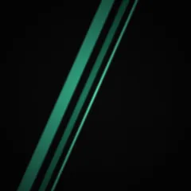</a>
  <a href="backgrounds/4-logo-glow.png"></a>
  <a href="backgrounds/5-logo-grid.png"></a>
  <a href="backgrounds/6-logo-lightbar.png">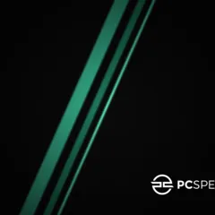</a>
  <a href="backgrounds/pcs-afterglow.jpg">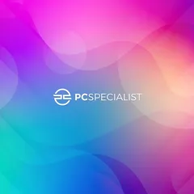</a>
  <a href="backgrounds/pcs-aurora.jpg">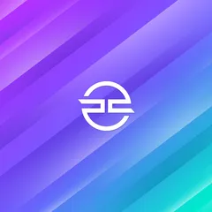</a>
  <a href="backgrounds/pcs-backtoschool.jpg">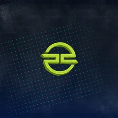</a>
  <a href="backgrounds/pcs-chromatic.jpg">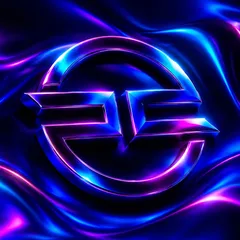</a>
  <a href="backgrounds/pcs-cobalt-sunset.jpg">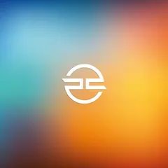</a>
  <a href="backgrounds/pcs-crystalline.jpg">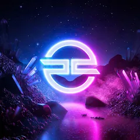</a>
  <a href="backgrounds/pcs-defiance.jpg">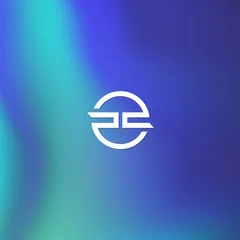</a>
  <a href="backgrounds/pcs-destian.jpg">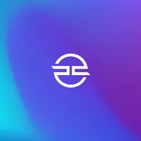</a>
  <a href="backgrounds/pcs-discord.jpg"></a>
  <a href="backgrounds/pcs-eclipse.jpg">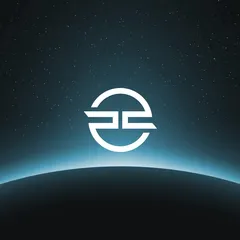</a>
  <a href="backgrounds/pcs-elimina.jpg">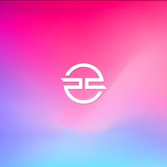</a>
  <a href="backgrounds/pcs-fusion.jpg"></a>
  <a href="backgrounds/pcs-gemini.jpg">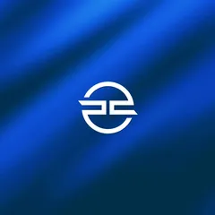</a>
  <a href="backgrounds/pcs-glitch.jpg">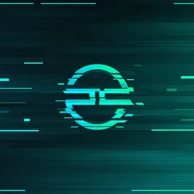</a>
  <a href="backgrounds/pcs-icon.jpg">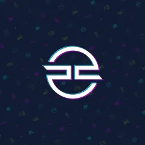</a>
  <a href="backgrounds/pcs-initia.jpg">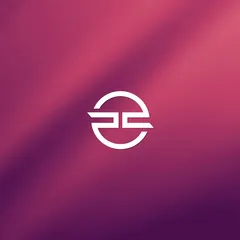</a>
  <a href="backgrounds/pcs-ionico.jpg">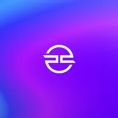</a>
  <a href="backgrounds/pcs-lafite.jpg"></a>
  <a href="backgrounds/pcs-liminality.jpg">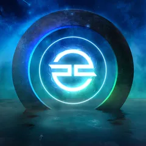</a>
  <a href="backgrounds/pcs-lineup2020.jpg">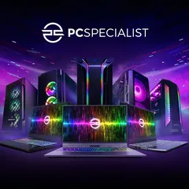</a>
  <a href="backgrounds/pcs-lineup2021.jpg">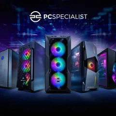</a>
  <a href="backgrounds/pcs-liquidseries1.jpg">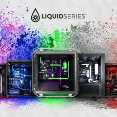</a>
  <a href="backgrounds/pcs-liquidseries2.jpg">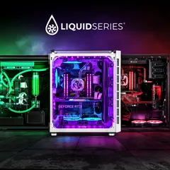</a>
  <a href="backgrounds/pcs-liquidseries3.jpg">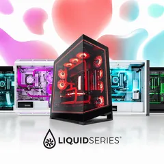</a>
  <a href="backgrounds/pcs-liquidseries-original.jpg">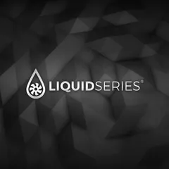</a>
  <a href="backgrounds/pcs-lumincloud.jpg"></a>
  <a href="backgrounds/pcs-lumin.jpg">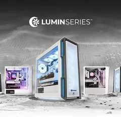</a>
  <a href="backgrounds/pcs-luminsetup.jpg">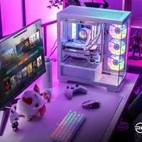</a>
  <a href="backgrounds/pcs-minskybuilder.jpg">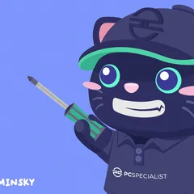</a>
  <a href="backgrounds/pcs-minskylocked.jpg">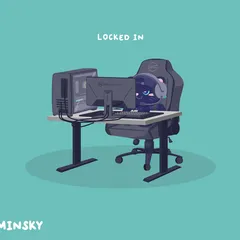</a>
  <a href="backgrounds/pcs-minskynotawake.jpg">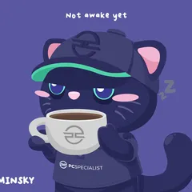</a>
  <a href="backgrounds/pcs-minskypc.jpg">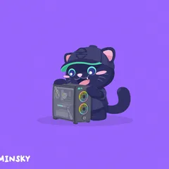</a>
  <a href="backgrounds/pcs-neonchrome.jpg">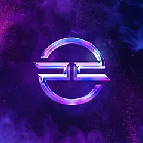</a>
  <a href="backgrounds/pcs-original.jpg"></a>
  <a href="backgrounds/pcs-original-white.jpg"></a>
  <a href="backgrounds/pcs-recoil.jpg">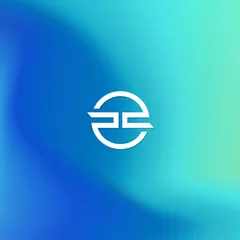</a>
  <a href="backgrounds/pcs-spectrum.jpg">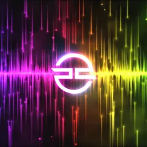</a>
  <a href="backgrounds/pcs-spectrum-light.jpg">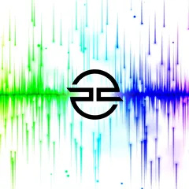</a>
  <a href="backgrounds/pcs-valeon.jpg">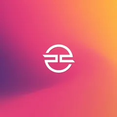</a>
  <a href="backgrounds/pcs-vanguard.jpg"></a>
  <a href="backgrounds/pcs-vanguard-pulse.jpg">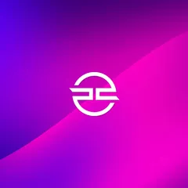</a>
  <a href="backgrounds/pcs-vyper.jpg">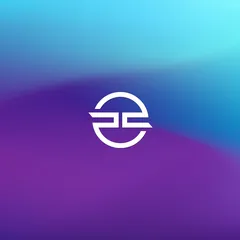</a>
  <a href="backgrounds/pcs-watercolour.jpg">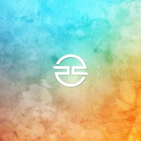</a>
  <a href="backgrounds/pcs-wireframedark.jpg">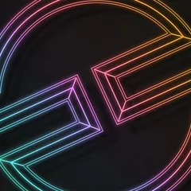</a>
  <a href="backgrounds/pcs-wireframelight.jpg">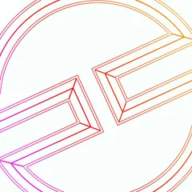</a>
  <a href="backgrounds/pcs-wireframeneon.jpg">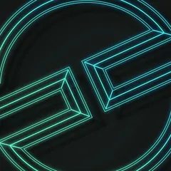</a>
</p>

PCSpecialist name and logo © PCSpecialist.
